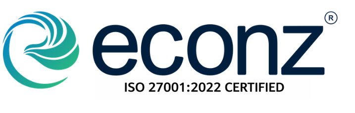

# AdminPro — Google Workspace Administration & Audit Platform

> Enterprise Google Workspace administration suite built with React, Vite, Tailwind CSS, Google REST APIs, and Gemini AI.



---

## 🚀 Features

- **Auth & Service Account DWD**: Direct RSA-256 JWT assertion exchange for 1-hour OAuth access tokens.
- **Enterprise Signatures**: Master HTML email signature templates with live multi-user Gmail API push.
- **User Email Aliases**: Domain user alias list, assignment, and bulk deletion.
- **Email Inspection & Recall**: Inspect message logs and trigger multi-mailbox recalls.
- **Google Groups Management**: Group listing, member additions, and role configuration.
- **Google Chat Audit**: Space discovery, membership inspection, and messaging controls.
- **Drive Files & Storage**: Search domain files, analyze quota usage, and audit permissions.
- **Gemini HR Candidate Evaluation**: AI-assisted resume screening and ATS scoring powered by Gemini 1.5 Pro.
- **Co-Branding**: Permanent Econz Digital provider branding with customizable client organization logo.

---

## 🛠️ Tech Stack

- **Frontend**: React 18, Vite 5, Tailwind CSS
- **Icons**: Lucide React
- **Authentication**: Service Account JSON with Domain-Wide Delegation (DWD)
- **Deployment Options**:
  - **Vercel**: Portfolio/Resume SPA deployment (`vercel.json`)
  - **Google Cloud Run**: Enterprise Docker container (`Dockerfile` + Nginx Alpine)

---

## 💻 Local Setup & Development

```bash
# 1. Clone the repository
git clone https://github.com/YOUR-USERNAME/adminpro.git
cd adminpro

# 2. Install dependencies
npm install

# 3. Start development server
npm run dev
```

---

## 🌐 Enterprise Deployment Options

### **Option 1: Vercel SPA Deployment**
```bash
npx vercel
```

### **Option 2: Google Cloud Run Container**
```bash
# Build Docker image
docker build -t gcr.io/YOUR_PROJECT_ID/adminpro .

# Push to Google Artifact Registry
docker push gcr.io/YOUR_PROJECT_ID/adminpro

# Deploy to Cloud Run
gcloud run deploy adminpro --image gcr.io/YOUR_PROJECT_ID/adminpro --platform managed --allow-unauthenticated
```

---

## 📄 License
Internal Enterprise Use • Econz Digital Solutions
